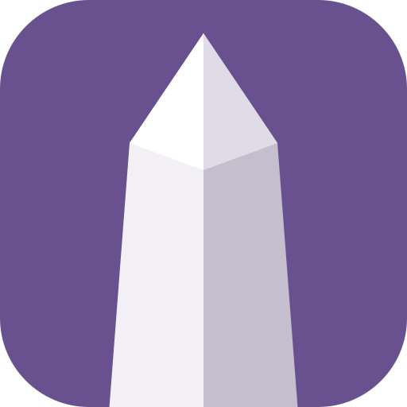
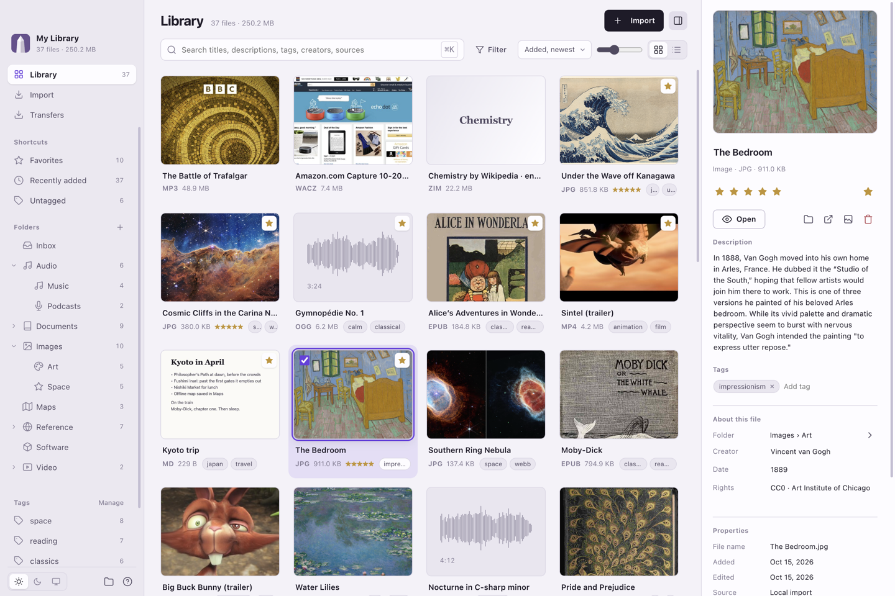
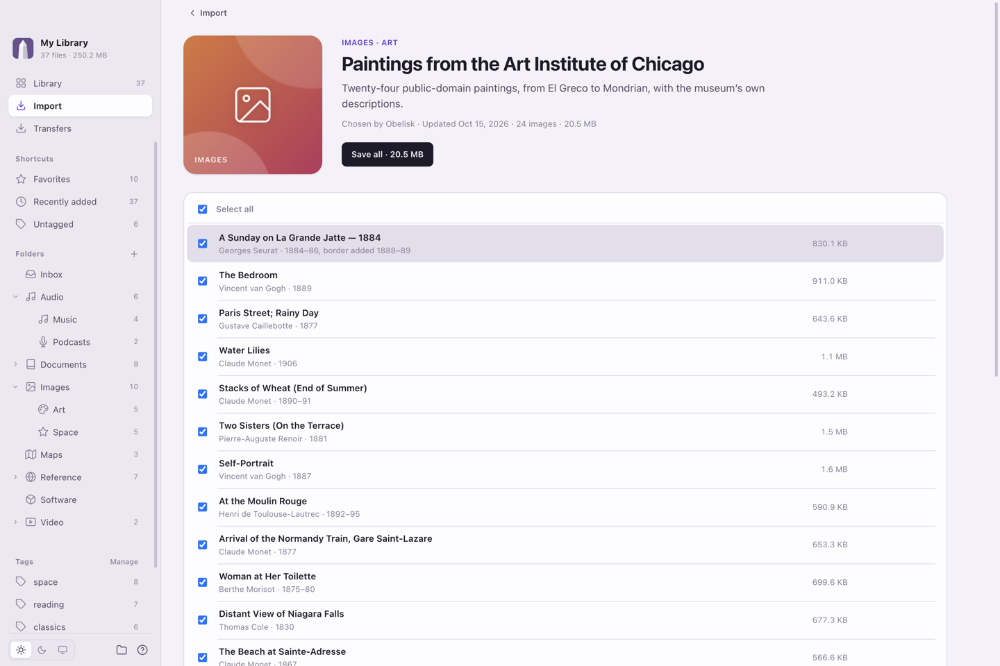
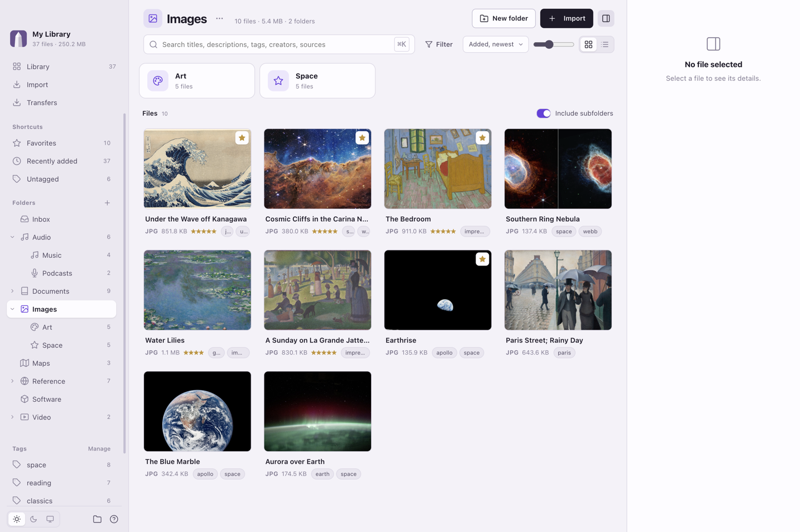
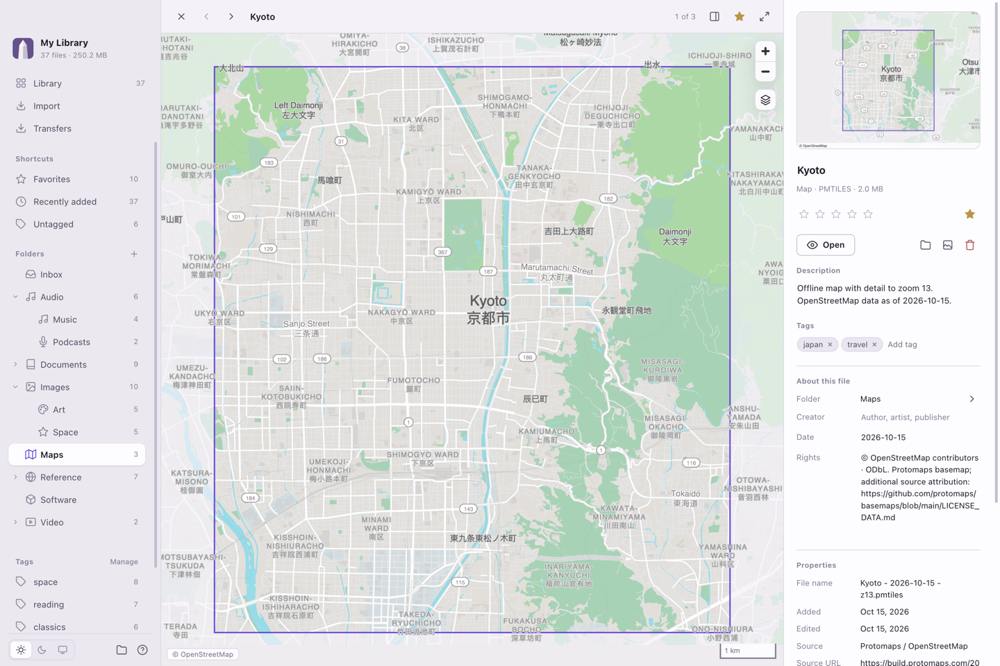
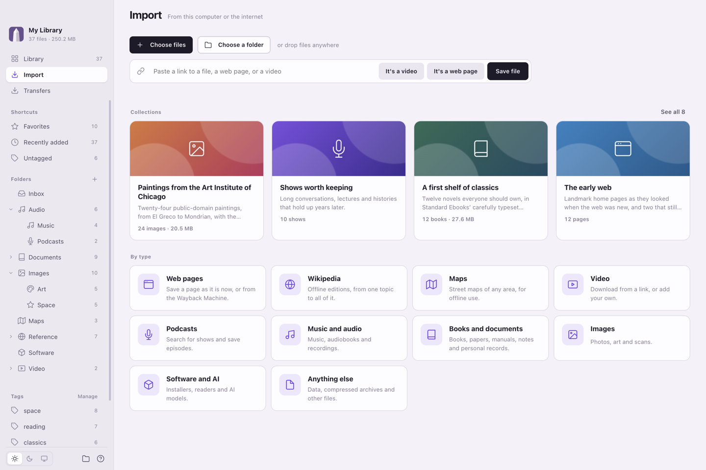
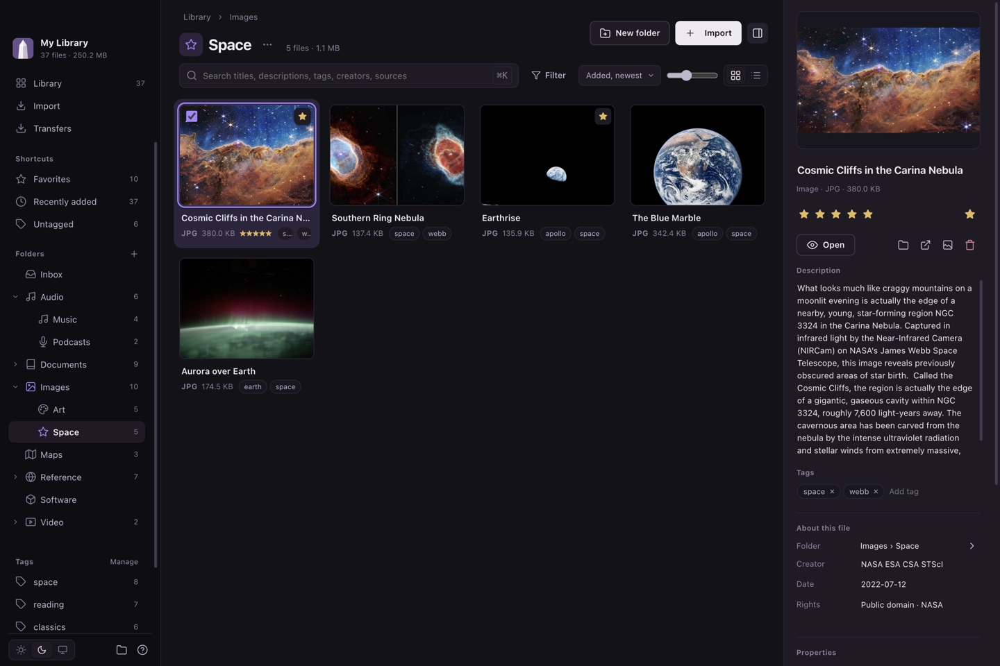

<p align="center">
  
</p>
<h1 align="center">Obelisk</h1>
<p align="center">
  <strong>Save the internet to your drive.</strong><br />
  A fast, free, open-source file manager for building and using an offline archive.
</p>
<p align="center">
  <a href="../../releases/latest"></a>
</p>
<!-- Once the repository is public, show its stars here:
<p align="center"><a href="../../stargazers"></a></p>
-->
<p align="center">
  <a href="#download">Download</a> ·
  <a href="#why-obelisk">Why Obelisk</a> ·
  <a href="#collections">Collections</a> ·
  <a href="#supported-content">Supported content</a> ·
  <a href="#contributing">Contributing</a>
</p>



## Download

Get the latest version from **[Releases](../../releases/latest)**:

| System                             | Download                                         | First launch                                                                                                        |
| ---------------------------------- | ------------------------------------------------ | ------------------------------------------------------------------------------------------------------------------- |
| **macOS** (Apple Silicon or Intel) | `Obelisk-mac-arm64.zip` or `Obelisk-mac-x64.zip` | Unzip and move Obelisk to Applications. It isn't signed by a registered developer yet, so the first time, open it, then choose **Open Anyway** in System Settings → Privacy & Security. |
| **Windows** (experimental)         | `Obelisk-windows-x64.zip`                        | Unzip and run `Obelisk.exe`. If Windows warns you, choose **More info → Run anyway**.                               |
| **Linux** (experimental)           | `Obelisk-linux-x64.zip`                          | Unzip and run `Obelisk`. If it won't start, run `sudo chown root chrome-sandbox && sudo chmod 4755 chrome-sandbox` in its folder. |

Obelisk is in beta. It's been tested most on Macs with Apple Silicon. Keep a backup of anything important. You can also [run it from source](#run-from-source).

## Why Obelisk

Obelisk saves the parts of the internet you want to keep: Wikipedia, maps, books, websites, videos, podcasts, art, and software. Store them alongside your own files in one organized archive on your computer or external drive.

**When the internet goes down, your archive remains usable.** Read documents, search Wikipedia, explore saved maps, watch videos, and listen to recordings without a connection. The readers are built in; the content is already on your drive.

Prepare for travel, unreliable connections, disappearing websites, or a more substantial disruption (Hugging Face incident, anyone?). Download while you have access. Keep the knowledge, tools, and personal records you may need.

**Obelisk is equal parts file manager and archiving tool**: organize what you already have, quickly find and download what you care about, and keep it all accessible offline.

## File management

Obelisk combines an advanced file organizer with the tools to acquire content. Search, browsing, and file access run locally, without waiting for a cloud service.

- **Organize:** folders you create and arrange, drag-and-drop, tags, titles, dates, sources and more.
- **Search:** metadata search, filters, favorites, ratings, and keyboard navigation.
- **Browse:** visual thumbnails, book covers, video frames, audio waveforms, and grid or list views.
- **Download:** dedicated sources, direct links, and a transfer queue with pause, retry, and cancellation.
- **View:** integrated readers and players, fullscreen video, and light and dark themes.

## Built-in Download Tools

Obelisk has a **built-in downloader** that saves content directly into your organized archive. Download Wikipedia, select a region of a map, save a podcast series, or capture a web page with Wayback Machine—all effortlessly from within the app.

## Collections

Not sure what to save? Collections are currated bundles of content you can download in one click: classic novels, museum paintings, public-domain films, early websites, shows worth keeping. Obelisk downloads and organizes it automatically.



Anyone can suggest a collection: it's one JSON file. See [collections/README.md](collections/README.md).

## Supported content

| Content                    | Offline use                                                                                   |
| -------------------------- | --------------------------------------------------------------------------------------------- |
| **Wikipedia**              | Download editions by topic and language. Read and search ZIM archives directly.               |
| **Maps**                   | Select a region and detail level. Explore saved PMTiles maps together in an offline atlas.    |
| **Websites**               | Capture individual pages or Wayback versions. Replay saved WACZ pages without network access. |
| **Books and documents**    | Read PDF, EPUB, Markdown, and text. Preserve papers, manuals, notes, and personal records.    |
| **Podcasts and audio**     | Find shows through public search or RSS. Save episodes, music, audiobooks, and recordings.    |
| **Video**                  | Download from a URL with yt-dlp or import your files. Watch locally, including in fullscreen. |
| **Images and art**         | Browse photographs, artwork, illustrations, and scans with visual previews.                   |
| **Software and AI models** | Keep installers, readers, and model files with their platform and setup requirements.         |
| **Other files**            | Store datasets, compressed archives, and any other files you need.                            |

Some formats need external applications; media playback depends on codecs. Obelisk stores software and models but does not install or run them. [Format details](packages/types/index.js).

<table>
  <tr>
    <td width="50%"><a href="docs/images/folder.png"></a></td>
    <td width="50%"><a href="docs/images/maps.png"></a></td>
  </tr>
  <tr>
    <td align="center"><strong>Folders</strong></td>
    <td align="center"><strong>Offline maps</strong></td>
  </tr>
  <tr>
    <td width="50%"><a href="docs/images/import.png"></a></td>
    <td width="50%"><a href="docs/images/dark.png"></a></td>
  </tr>
  <tr>
    <td align="center"><strong>Add content</strong></td>
    <td align="center"><strong>Dark mode</strong></td>
  </tr>
</table>

<p align="center"><sub>Demo screenshots. Map data © OpenStreetMap contributors. <a href="docs/third-party.md#demo-and-screenshots">Attribution</a>.</sub></p>

## Storage and preservation

A key feature of Obelisk is that your archive is a normal folder, not a proprietary container. Original files and readable metadata stay together to browse in your OS file system. Open them with other applications, copy the folder to another drive, or rebuild Obelisk's index from the archive itself. No account or cloud subscription is required.

Checksums and source records help preserve context and detect changes. Integrity checks identify missing, moved, or modified files. Packaged builds also save a copy of themselves in your library, so it opens on another computer without internet.

Archives are not encrypted or automatically backed up. Keep a second copy of important files. Synced folders such as iCloud Drive, Dropbox and OneDrive aren't supported; ideally, use a high-capacity external drive. [Library format](docs/library-format.md).

## Run from source

Requires **Node.js 22.18 or later**. Clone this repository, then run:

```sh
npm ci
npm start
```

On first launch a short setup explains how the app works and creates your library on the drive you choose, or opens one you already have. The guide is available later from the help button.

Map downloads require `npm run setup:maps`. Video downloads offer an in-app setup step. Downloads and initial setup need internet access; reading and using supported saved content do not.

[What is and isn’t verified](CONTRIBUTING.md#testing) · [Roadmap](docs/roadmap.md)

## Contributing

If Obelisk is useful to you, a ⭐ on GitHub helps other people find it.

Contribute collections, download sources, readers, interface improvements, documentation, or testing on Windows and Linux. Obelisk uses Electron, JavaScript, HTML, and CSS. Start with [CONTRIBUTING.md](CONTRIBUTING.md); agents should read [AGENTS.md](AGENTS.md).

```sh
npm run check          # Syntax checks
npm test               # Core tests
npm run test:desktop   # Desktop checks
npm run build          # Bundle assets
npm run package        # Build for this computer
npm run release -- 0.2.0 --push   # Tag a release; CI builds and publishes it
```

Releasing is described in [CONTRIBUTING.md](CONTRIBUTING.md#releasing).

## License

Project-authored code is [MIT licensed](LICENSE). Release builds include the OpenZIM Wikipedia reader, so they're distributed under **GPL-3.0-or-later**, with their complete source attached to each release. Third-party software and archived content retain their respective licenses. [Licensing details](docs/third-party.md).
